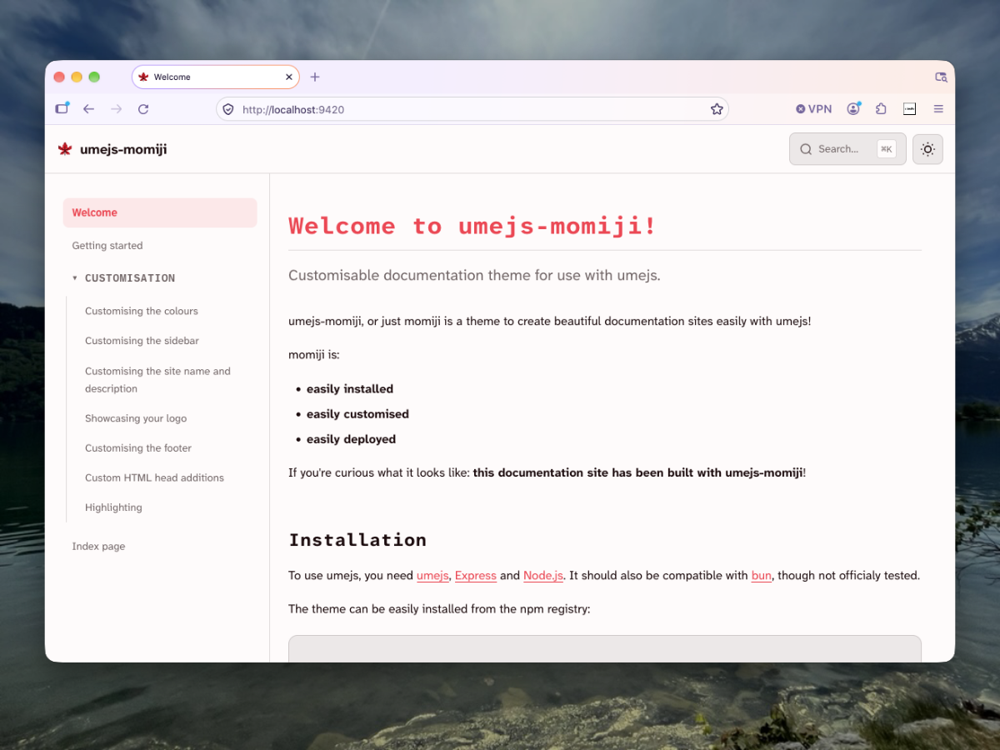

# umejs-momiji

## Customisable documentation theme for use with umejs



umejs-momiji, or just Momiji is a theme for [umejs](https://ume.dantenl.com), allowing you to easily create a documentation site! All you have to provide is the content for on the site.

It's a theme that can be **easily installed**, **easily customised** and **easily deployed**!

---

To get started, I'd recommend reading the full [getting started page](#) on the site.

If you don't like to read: here's a full example of an index.js page with this theme:

```js
// index.js

// For ESM:
// Comment this out if you're on CommonJS!
import express from 'express';
import { default as ume } from '@dantenl/umejs';
import path from 'node:path';
import { fileURLToPath } from 'url';

const __dirname = path.dirname(fileURLToPath(import.meta.url));

// For CommonJS:
// Comment this out if you're on ESM/TS!
const express = require('express');
const ume = require('@dantenl/umejs');
const path = require('path');

// --- Initialise Express ---
const app = express();
const PORT = 3000;

// --- Initialise umejs ---
const umeConfig = ume({
    contentDir: path.join(__dirname, 'content'),
    themes: ['@dantenl/umejs-momiji'],
    // ! ^crucial^ !
});

// --- Set up the umejs middleware ---
app.use('/docs/{*slug}', umeConfig);

// --- Get the server running ---
app.listen(PORT, () => {
    console.log(`Server running at http://localhost:${PORT}`);
});
```
